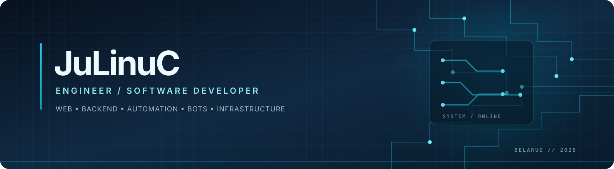

  

<h1 align="center">JuLinuC</h1>

  <em>Engineer by profession. Developer by curiosity. Builder by habit.</em>

  
  
  
  

  <strong>I design and develop applications, bots, automation tools, and infrastructure.</strong> 
  From the first interface to the backend, database, and production deployment.

---

## What I've built

The repositories below include both public and private work. Private projects are presented as portfolio case studies; implementation details and source code remain private.

### Corupcionery — community platform

  

A connected web platform and service ecosystem created for a Minecraft community. The project brings the website, community operations, and Telegram communication into one system.

- Built a web interface with user-facing pages and administrative workflows.
- Connected the website to a Telegram bot for community notifications and interactions.
- Designed backend services and database-backed functionality.
- Prepared a self-hosted deployment environment with containers and reverse proxy.

**Technologies:** React · Vite · Node.js · Express · Prisma · PostgreSQL · Telegram Bot API · Docker · Caddy

Repository: private

---

### GANG4 — Telegram Mini App for student life

  

A Telegram-first application designed to support student community and dormitory workflows. The goal is to make everyday coordination and administration available from one familiar interface.

- Developed a Telegram Mini App connected to a bot.
- Worked on authentication and user access flows.
- Designed functionality for duty schedules and administrative tasks.
- Integrated notifications and community coordination features.

**Technologies:** React · JavaScript · Node.js · Telegram Mini Apps · Telegram Bot API

Repository: private

---

### Lumina — Discord bot ecosystem

  

A modular Discord automation project focused on server management and community experience.

- Personal role management.
- Personal voice-channel creation and management.
- Permission management and application workflows.
- User profiles, utilities, and modular command architecture.

**Technologies:** Python · Discord API · Database-backed modules · Docker

Repository: private

---

### ShopManager — Minecraft Fabric mod

  

A client-side mod concept for managing in-game shops and tracking their inventory.

- Product catalogue with configurable prices and stock targets.
- Chest-coordinate configuration and inventory monitoring.
- Tracking of items added and taken from shop storage.
- Custom dashboard interface for shop management.

**Technologies:** Java · Fabric · Minecraft client modding

Development project

---

## Public repositories

  
  

- **[OpenRepos Register](https://github.com/zxcadf/register)** — an open-source way to claim free subdomains for open-source projects.
- **[Personal website](https://github.com/zxcadf/zxcadf.github.io)** — my personal website and web experiments.
- **[by-JuLinuC](https://github.com/zxcadf/by-JuLinuC)** — personal code and experiments.

## Technology

  

  
  
  
  

## Development setup

| Device | Specification |
|---|---|
| Laptop | Lenovo Legion 5 |
| CPU | AMD Ryzen 7 5800H |
| GPU | NVIDIA GeForce RTX 3060 Laptop |
| Memory | 16 GB DDR4 |
| Storage | 512 GB NVMe |
| Display | 165 Hz |
| Mouse | Ajazz 159 White |
| Keyboard | REDRAGON LAKSHMI K606R |

## GitHub activity

  
  

  

---

  <em>Build useful things. Keep learning. Make it work.</em>
    
  

