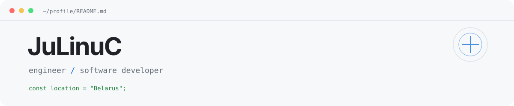
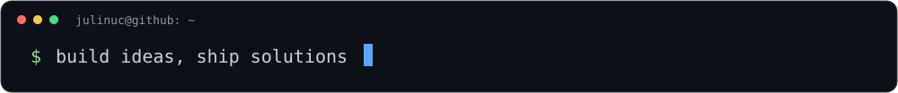

<div align="center">

<picture>
  <source media="(prefers-color-scheme: dark)" srcset="https://raw.githubusercontent.com/zxcadf/zxcadf/main/assets/profile/header-dark.svg">
  
</picture>

<br>

<a href="https://github.com/zxcadf"></a>


<br><br>



</div>

### Обо мне

Инженер из **Беларуси**. Разрабатываю веб-приложения, ботов и инструменты автоматизации. Люблю собирать проекты целиком — от интерфейса и API до базы данных и развёртывания на сервере.

```ts
const julinuc = {
  role: "Engineer & Developer",
  focus: ["Web", "Backend", "Bots", "Infrastructure"],
  currently: ["Telegram Mini Apps", "Docker", "Rust"],
};
```

### Технологии

<div align="center">


</div>

### Что создаю

- **Веб-приложения** — интерфейсы, backend, API и интеграции.
- **Боты и автоматизация** — Telegram, Discord и инструменты для сообществ.
- **Инфраструктура** — Docker, Linux, VPS/VDS и self-hosted сервисы.
- **Игровые инструменты** — Minecraft, Java и серверные решения.

### 04 / Сейчас изучаю

`Backend Architecture` · `Telegram Mini Apps` · `Docker & CI/CD` · `Java & Fabric` · `Rust`

### Рабочее место

<details>
<summary>Lenovo Legion 5 · характеристики и периферия</summary>

- **CPU:** AMD Ryzen 7 5800H
- **GPU:** NVIDIA GeForce RTX 3060 Laptop
- **RAM:** 16 GB DDR4
- **Storage:** 512 GB NVMe
- **Display:** 165 Hz
- **Mouse:** Ajazz 159 White
- **Keyboard:** REDRAGON LAKSHMI K606R

**Инструменты:** VS Code · Termix · Docker · Portainer · Pterodactyl · VDS/VPS

</details>

### GitHub

<div align="center">

<sub>Создаю. Изучаю. Улучшаю.</sub>

</div>
