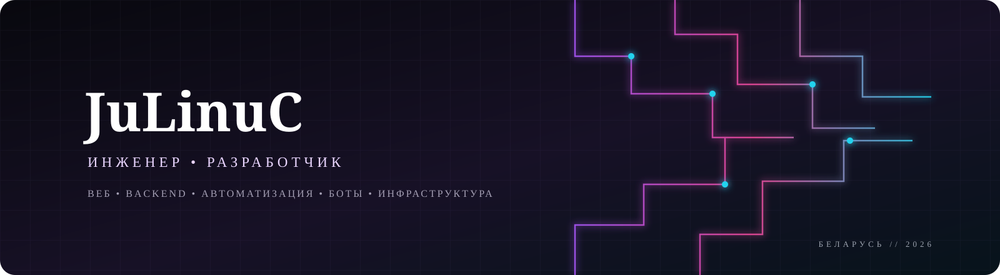
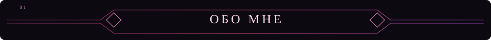
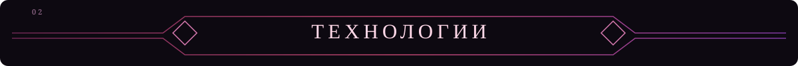
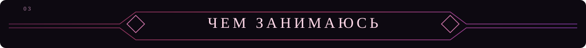
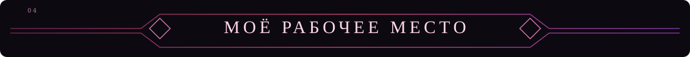
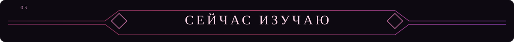
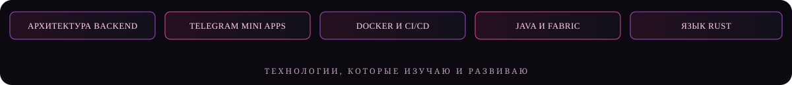
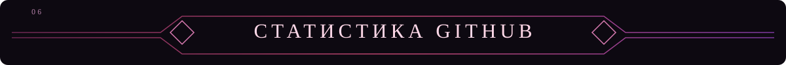

 

  

### От идеи — к коду. От кода — к работающей системе.

*Разработка ПО · Веб-приложения · Автоматизация · Боты · Инфраструктура · Minecraft*

---

<table>
<tr>
<td width="55%" valign="top">

### Привет, я JuLinuC 👋

Я инженер из **Беларуси**, увлекаюсь разработкой программного обеспечения и созданием собственных цифровых продуктов.

Мне нравится разрабатывать решения целиком: продумывать интерфейс, писать серверную логику, подключать базы данных и внешние сервисы, а затем разворачивать и поддерживать приложение на собственном сервере.

Интересуюсь новыми технологиями, экспериментирую с инструментами и стараюсь доводить идеи до работающего результата.

</td>
<td width="45%" valign="top">

### Кратко обо мне

| | |
|:--|:--|
| **Профессия** | Инженер |
| **Возраст** | 20 лет |
| **Страна** | Беларусь |
| **Направление** | Разработка ПО |
| **Интересы** | Web, Backend, Bots, DevOps |

</td>
</tr>
</table>

### Языки программирования

  

### Frontend и Backend

 

  

### Инфраструктура и инструменты

  

<table>
<tr>
<td width="50%" valign="top">

<h3>✦ Веб-разработка</h3>

Создаю адаптивные интерфейсы и веб-приложения — от пользовательской части до серверной логики и интеграций.

React · JSX · JavaScript · Node.js · PHP

</td>
<td width="50%" valign="top">

<h3>✦ Боты и автоматизация</h3>

Разрабатываю ботов и интеграции, которые связывают сообщества, приложения и внешние сервисы, упрощая повседневные процессы.

Python · Node.js · Telegram API · Discord API

</td>
</tr>
<tr>
<td width="50%" valign="top">

<h3>✦ Серверы и инфраструктура</h3>

Настраиваю серверное окружение, контейнеризацию и развёртывание приложений на VPS/VDS. Работаю с self-hosted сервисами.

Docker · Portainer · Linux · VDS/VPS · Pterodactyl

</td>
<td width="50%" valign="top">

<h3>✦ Игровые проекты</h3>

Работаю с Minecraft-экосистемой: серверные инструменты, автоматизация, игровые сообщества и изучение разработки модификаций.

Java · Fabric · Minecraft · Server tooling

</td>
</tr>
</table>

| Компонент | Характеристики |
|:--|:--|
| **Ноутбук** | Lenovo Legion 5 |
| **Процессор** | AMD Ryzen 7 5800H |
| **Видеокарта** | NVIDIA GeForce RTX 3060 Laptop |
| **Оперативная память** | 16 GB DDR4 |
| **Накопитель** | 512 GB NVMe |
| **Дисплей** | 165 Hz |

### Периферия

 

---

**Любопытство рождает идеи. Инженерный подход превращает их в результат.**

